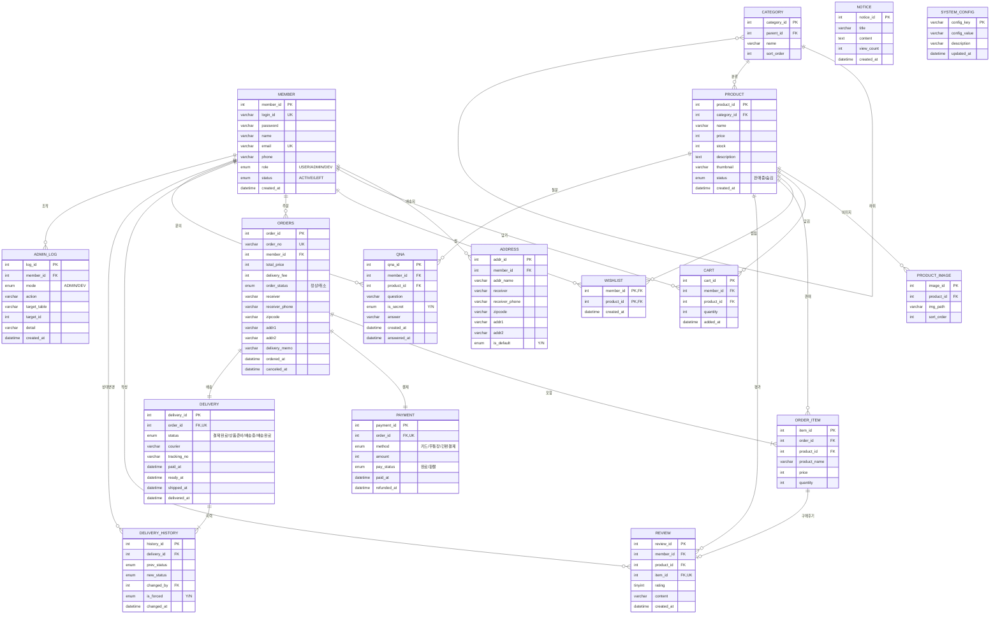

<div align="center">

# 웹프로그래밍응용_기말프로젝트_쇼핑몰

</div>

#### Languages


#### Tools


#### Platform


#### Server


#### AI Agent


---
## Table of Contents

- [Project Overview](#project-overview)
- [아키텍처 명세](#아키텍처-명세architecture)
- [DB 설계 명세](#db-설계-명세database)
  - [ERD](#erd)
  - [테이블 명세](#테이블-명세tables)
  - [DDL](#ddl)
- [기능 구현 명세](#기능-구현-명세features)
- [핵심 구현 명세](#핵심-구현-명세implementation)
- [URL 매핑 명세](#url-매핑-명세url-mapping)
- [UI](#ui)
- [Project Structure](#project-structure)
- [Build & Run](#build--run)
  - [Prerequisites](#prerequisites)
  - [DB 초기화](#db-초기화)
  - [Eclipse 설정](#eclipse-설정)
  - [Run](#run)
  - [Deploy (WAR)](#deploy-war)
- [License](#license)
- [Author](#author)
- [Motivation](#motivation)
---

## Project Overview

> 이 브랜치(`zyonge_LLMIntegration`)는 **LLM API 연동 실험용**이다. `zyonge_Sandbox` 의 구현을 그대로 가져와 LLM API 삽입을 개발하며, 제출 산출물인 `main` 에는 병합하지 않는다.

- **아키텍처**: Servlet(Controller) · Service · DAO · DTO 4계층 MVC + 역할별 Filter 체인, 뷰는 JSP + JSTL
- **DB 연동**: Tomcat JNDI DataSource(`jdbc/shop`, commons-dbcp 커넥션 풀) · MySQL 9.6 · 스키마 `webapplication_sandbox`
- **인증 방식**: 세션 로그인 + 3역할 완전 격리(`USER` 구매 / `ADMIN` 상품·주문 관리 / `DEV` 데이터·상태 조작)

### 개발 현황

| 트랙 | 상태 | 내용 |
|---|---|---|
| ERD | 🟢 완료 | 테이블 17 · 뷰 5 · CRUD 매트릭스 · DTO 필드 계약 ([docs/ERD.md](docs/ERD.md), [docs/CRUD.md](docs/CRUD.md)) |
| DB Schema | 🟢 구축 완료 | FK 21 · CHECK 8 · UNIQUE 9, ERD 대조 불일치 0 |
| JSP 배선 | 🟢 전 화면 배선 | 자바 클래스 84 · JSP 39 · 필터 6, Tomcat 실행 검증 완료 |
| UI / UX | 🟡 청사진 | CSS 17개 · 목업 8개. 디자인 컨셉(색·타이포 값) 전달 대기 |

PM 결정 대기 항목은 [docs/STATUS.md](docs/STATUS.md)에 있다.

---

## 아키텍처 명세(Architecture)

| 계층 | 구성 요소 | 역할 |
|---|---|---|
| Controller | `shop.controller` — `*Servlet` 24개 + `BaseServlet` | `@WebServlet` 정확 일치 매핑, 요청 파라미터 처리, JSP forward |
| Model | `shop.service` (9) · `shop.dao` (16) · `shop.dto` (21) | 업무 규칙과 트랜잭션 / SQL 실행 / 화면 데이터 전달 |
| View | `WebContents/{영역}/*.jsp` (39) | JSTL · EL 렌더링, 팝업은 `<dialog>` 인페이지 모달 |
| Filter | `shop.filter` (6) | 인코딩 · JSP 직접 접근 차단 · 점검 모드 · 역할별 접근 제어 |

```
요청 ─▶ EncodingFilter ─▶ JspDirectAccessFilter ─▶ ShopFilter ─▶ UserFilter / AdminFilter / DevFilter
                                                       │ (점검 모드면 비로그인·USER → /maintenance)
     ─▶ *Servlet ─▶ *Service ─▶ *DAO ─▶ DBUtil(JNDI jdbc/shop) ─▶ MySQL
     ◀─ JSP (forward) ◀─ DTO
```

---

## DB 설계 명세(Database)

### ERD

상세 명세(공통 규약 · 제약 · 업무 규칙 · 불변식 · DTO 계약)는 [docs/ERD.md](docs/ERD.md)에 있다.



### 테이블 명세(Tables)

| 테이블 | 설명 | 주요 컬럼 |
|---|---|---|
| `member` | 회원 | `login_id` · `password` · `name` · `role`(USER/ADMIN/DEV) · `status` |
| `address` | 회원 배송지 | `member_id` · 수령인 · 우편번호 · 주소 · `is_default` |
| `category` | 카테고리 (자기참조 계층) | `parent_id` · `name` |
| `product` | 상품 | `category_id` · `name` · `price` · `stock` · `status`(판매중/숨김) · `thumbnail` |
| `product_image` | 상품 이미지 | `product_id` · `img_path` |
| `cart` | 장바구니 | `member_id` · `product_id` · `quantity` |
| `wishlist` | 찜 | `member_id` · `product_id` |
| `orders` | 주문 | `order_no` · `member_id` · `total_price` · `delivery_fee` · `order_status` · `canceled_at` |
| `order_item` | 주문 상품 (주문 시점 스냅샷) | `order_id` · `product_id` · 상품명 · 가격 · 수량 |
| `payment` | 결제 (모의) | `order_id` · 결제수단 · `pay_status` · `refunded_at` |
| `delivery` | 배송 | `order_id` · `status` · `courier` · `tracking_no` |
| `delivery_history` | 배송 상태 이력 | `delivery_id` · 이전/이후 상태 · 변경자 · `is_forced` |
| `review` | 리뷰 | `item_id` · `product_id` · `rating` · 내용 |
| `qna` | 상품 문의 | `member_id` · `product_id` · `question` · `answer` · `answered_at` |
| `notice` | 공지사항 | 제목 · 내용 · 작성일 |
| `system_config` | 전역 설정 | `SHOP_STATUS` · `DELIVERY_FEE` · `FREE_SHIPPING_MIN` · `LOW_STOCK_THRESHOLD` |
| `admin_log` | 관리자 · dev 조작 기록 | `member_id` · `mode` · `action` · `target_table` · `detail` |

| 뷰 | 용도 |
|---|---|
| `v_sales_daily` | 일별 매출 (정상 주문만) |
| `v_delivery_status_count` | 배송 상태별 건수 |
| `v_admin_order` | 관리자 주문 목록 (회원 · 결제 · 배송 · 상품 수 · 첫 상품명) |
| `v_admin_member` | 관리자 회원 목록 (주문 수 · 결제 합계 · 미답변 문의) |
| `v_low_stock` | 재고 부족 상품 |

### DDL

| 파일 | 내용 | 실행 계정 |
|---|---|---|
| [sql/00_create_database.sql](sql/00_create_database.sql) | DB 생성 + 개발 계정 권한 부여 (1회) | 관리자(root) |
| [sql/schema.sql](sql/schema.sql) | 테이블 17 · 뷰 5 생성 (재실행 가능) | 개발 계정 |
| [sql/data.sql](sql/data.sql) | 샘플 데이터 (재실행 시 전체 초기화) | 개발 계정 |

---

## 기능 구현 명세(Features)

### 고객 (USER)

- 회원가입 · 로그인 · 아이디 중복 확인 · 정보 수정 · 비밀번호 변경 · 탈퇴
- 상품 목록 · 카테고리 · 검색 · 상세 (판매중 + 재고 있는 상품만 노출)
- 장바구니 · 찜 (재고 없는 상품은 "재고 없음" 표시, 주문에서 제외)
- 주문서 → 모의 결제 → 주문 완료 · 주문 내역 · 상세 · 취소(결제완료·상품준비 단계만)
- 배송지 관리(기본 배송지) · 리뷰 작성/수정(배송완료 건, 구매 건당 1회) · 상품 문의

### 관리자 (ADMIN)

- 대시보드 (일별 매출 · 배송 상태 건수 · 재고 부족)
- 상품 · 카테고리 관리, 주문 · 배송 관리(운송장 입력, 단계 전이)
- 회원 탈퇴 처리 · 문의 답변 · 리뷰 삭제 · 공지 관리
- 모든 조작은 `admin_log` 에 기록

### 개발자 (DEV)

- 상태 컨트롤러 (점검 모드 전환, 주문 · 배송 상태 강제 전환)
- 데이터 브라우저 (화이트리스트 테이블 · 뷰 조회) · 설계 보기 (ERD · 실제 스키마)
- 데이터 관리 (샘플 초기화) · 계정 전환(login-as) · 감사 로그

### 공개

- 메인 · 공지사항 · 점검 안내 페이지

---

## 핵심 구현 명세(Implementation)

### 결제 트랜잭션

주문 → 주문번호 부여 → 주문 상품 → 결제 → 배송 → 배송 이력 → 재고 차감 → 장바구니 비우기를 **한 트랜잭션**으로 처리한다. 재고 차감은 `UPDATE ... WHERE stock >= ?` 로 하고, 0행이면 전체를 rollback 해 동시 주문에서 재고가 음수가 되지 않게 한다.

### 3역할 완전 격리

| 경로 | 비로그인 | USER | ADMIN | DEV |
|---|---|---|---|---|
| 공개 탐색 (메인 · 상품 · 공지) | ○ | ○ | ○ | ○ |
| 구매 (`/cart` · `/order` · `/mypage` · `/wish`) | 로그인으로 | ○ | ✕ | ✕ |
| `/admin/*` | ✕ | ✕ | ○ | ✕ |
| `/dev/*` | ✕ | ✕ | ✕ | ○ |

가입은 항상 `USER` 이고, `ADMIN` · `DEV` 계정은 `data.sql` 로만 만든다. 역할은 생성 후 바뀌지 않는다. DEV 의 계정 전환은 원래 DEV 를 `impersonatorId` 로 보관하고, 전환 중 조작은 `admin_log` 에 `impersonated_by` 로 남는다.

### 배송 상태 전이

`UPDATE delivery SET status = ? WHERE status = <직전 상태>` 로 전이하고 0행이면 rollback 한다. 성공하면 `delivery_history` 와 `admin_log` 를 함께 기록한다. 취소 · 환불 · 배송중 전환은 관련 시각 · 운송장 컬럼을 같은 UPDATE 에서 써야 하며, 어기면 DB 의 CHECK 제약이 거부한다.

### 점검 모드

`system_config.SHOP_STATUS` 가 `MAINTENANCE` 이면 `ShopFilter` 가 비로그인 · USER 요청을 점검 안내로 보낸다. 관리자 · dev 경로, 로그인, 정적 자원은 통과한다.

---

## URL 매핑 명세(URL Mapping)

서블릿은 `@WebServlet` **정확 일치** 매핑만 쓴다. `/xxx/*` 와일드카드는 JSP 디렉터리와 접두어가 같아 forward 가 같은 서블릿으로 되돌아오는 무한 순환이 생긴다.

| 영역 | URL | Servlet | View |
|---|---|---|---|
| 공개 | `/` · `/main` | `MainServlet` | `main.jsp` |
| 공개 | `/member/join` · `/member/login` · `/member/logout` · `/member/idcheck` | `MemberServlet` | `member/*.jsp` |
| 공개 | `/product/list` · `/product/view` | `ProductServlet` | `product/*.jsp` |
| 공개 | `/notice/list` · `/notice/view` | `NoticeServlet` | `notice/*.jsp` |
| 공개 | `/maintenance` | `MaintenanceServlet` | `maintenance.jsp` |
| USER | `/cart/list` · `/cart/add` · `/cart/update` · `/cart/delete` | `CartServlet` | `cart/list.jsp` |
| USER | `/wish/toggle` · `/wish/remove` | `WishServlet` | (redirect) |
| USER | `/order/form` · `/order/pay` · `/order/complete` · `/order/list` · `/order/view` · `/order/cancel` | `OrderServlet` | `order/*.jsp` |
| USER | `/mypage/` · `/mypage/edit` · `/mypage/password` · `/mypage/leave` · `/mypage/address` · `/mypage/wishlist` · `/mypage/review` · `/mypage/qna` | `MypageServlet` | `mypage/*.jsp` |
| ADMIN | `/admin/dashboard` | `AdminDashboardServlet` | `admin/dashboard.jsp` |
| ADMIN | `/admin/products` · `/admin/categories` | `AdminProductServlet` · `AdminCategoryServlet` | `admin/*.jsp` |
| ADMIN | `/admin/orders` · `/admin/members` | `AdminOrderServlet` · `AdminMemberServlet` | `admin/*.jsp` |
| ADMIN | `/admin/qna` · `/admin/notices` · `/admin/reviews` | `AdminQnaServlet` · `AdminNoticeServlet` · `AdminReviewServlet` | `admin/*.jsp` |
| DEV | `/dev/` · `/dev/state` | `DevHubServlet` · `DevStateServlet` | `dev/*.jsp` |
| DEV | `/dev/data` · `/dev/erd` · `/dev/seed` | `DevDataServlet` · `DevErdServlet` · `DevSeedServlet` | `dev/*.jsp` |
| DEV | `/dev/loginAs` · `/dev/loginAs/return` · `/dev/log` | `DevLoginAsServlet` · `DevLogServlet` | `dev/*.jsp` |

팝업(문의 · 리뷰 · 배송지 · 상품 등록 · 운송장 · 답변 · 공지)은 별도 라우트 없이 부모 화면에 포함되며, 부모 화면의 URL 로 제출한다.

---

## UI

현재 CSS 는 **청사진** 단계다. 흰 바탕에 객체 종류(이미지 · 입력 · 버튼 · 데이터 · 팝업 · 내비 · 상태)를 색으로 구분해 배선 확인용으로 쓰며, 디자인 컨셉이 전달되면 `css/base/variables.css` 의 토큰 값만 교체한다.

| 항목 | 현재 |
|---|---|
| 레이아웃 | 고정폭 1200px 중앙 정렬 (반응형 범위 외) |
| CSS | `base/` 3 · `components/` 6 · `pages/` 8 — 로드 순서 reset → variables → layout → components → pages |
| 팝업 | `<dialog>` + `showModal()` 인페이지 모달 |
| 목업 | `WebContents/mockup/` 8개 (헤더 4종 · 구매 영역 3종 포함) |
| 결정 기록 | [WebContents/css/DECISIONS.md](WebContents/css/DECISIONS.md) — 토큰 이름 · 클래스 네이밍 · 팝업 패턴 |

---

## Project Structure

```
WebApplication_TermProject/
├── src/main/java/shop/
│   ├── controller/       # Servlet 24 + BaseServlet
│   ├── service/          # 업무 규칙 · 트랜잭션
│   ├── dao/              # SQL 실행
│   ├── dto/              # 화면 데이터 객체
│   ├── filter/           # Encoding · JspDirectAccess · Shop · User · Admin · Dev
│   └── util/             # DBUtil(JNDI) · Paging · RoleUtil 등
├── WebContents/          # 웹 루트
│   ├── main.jsp · maintenance.jsp
│   ├── common/           # header · footer · paging · error404 · error500
│   ├── member/ product/ cart/ order/ mypage/ notice/
│   ├── admin/            # 관리자 화면
│   ├── dev/              # 개발자 화면
│   ├── css/              # base · components · pages + DECISIONS.md
│   ├── mockup/           # 정적 HTML 목업 (UI 트랙)
│   ├── js/               # ui.js(팝업) · validate.js(폼 검증)
│   ├── images/ · upload/ # 정적 이미지 · 업로드 (upload 는 git 제외)
│   ├── META-INF/         # context.xml.example (context.xml 은 git 제외)
│   └── WEB-INF/          # web.xml · lib/ (라이브러리 6개)
├── sql/                  # 00_create_database · schema · data
├── docs/                 # ERD · CRUD · STATUS · tracks/ (트랙별 현황)
└── README.md
```

---

## Build & Run

### Prerequisites

| 항목 | 버전 |
|---|---|
| JDK | OpenJDK 17.0.19 |
| Apache Tomcat | 9.0.117 (Servlet 4.0 / JSP 2.3) |
| Dynamic Web Module | 4.0 |
| MySQL | 9.6.0 |
| MySQL Connector/J | 9.7.0 |
| IDE | Eclipse IDE for Enterprise Java and Web Developers 4.39 (2026-03) |
| DB Client | DBeaver, HeidiSQL |

### DB 초기화

```bash
mysql -u root -p < sql/00_create_database.sql
mysql -D webapplication_sandbox < sql/schema.sql
mysql -D webapplication_sandbox < sql/data.sql
```

- 첫 줄은 관리자 계정으로 한 번만 실행한다. 나머지는 개발 계정으로 실행하며, 다시 돌리면 DB 가 샘플 상태로 초기화된다.
- Homebrew mysql 클라이언트는 기본 문자셋이 latin1 이라 한글이 깨진 채 적재된다. `~/.my.cnf` 의 `[client]` 에 `default-character-set=utf8mb4` 를 넣고 실행한다.

### Eclipse 설정

1. `File > Import > Existing Projects into Workspace` 로 이 폴더를 연다. 프로젝트명은 `WebApplication_TermProject_LLM` 라 `main` 체크아웃과 동시에 Import 할 수 있다.
2. `WebContents/META-INF/context.xml.example` 을 `context.xml` 로 복사하고 스키마명 · 계정 · 비밀번호를 채운다.
3. Tomcat 9.0 런타임에 프로젝트를 추가한다.

### Run

1. Eclipse 에서 Tomcat 을 시작한다.
2. 아래 주소로 접속한다.

```
http://localhost:8080/WebApplication_TermProject_LLM/
```

| 샘플 계정 | 역할 | 비밀번호 |
|---|---|---|
| `hong` · `kim` | USER | `test1234` |
| `admin` | ADMIN | `test1234` |
| `devops` | DEV | `test1234` |

> Eclipse 가 아니라 CLI 로 Tomcat 을 띄울 때 `conf/Catalina/localhost/*.xml` 로 컨텍스트를 선언하면 `META-INF/context.xml` 이 무시돼 DB 풀이 연결되지 않는다.

### Deploy (WAR)

이 프로젝트는 localhost 범위에서만 실행한다. WAR 로 묶을 때는 `File > Export > WAR file` 을 쓰고, `context.xml` 이 WAR 에 포함되는지 확인한다.

---

## License

This project is licensed under the MIT License.

See the [LICENSE](LICENSE) file for details.

---

## Author

Name: Jiyong Kim, Hawon Yoon, Minjun Kim

Profile: https://github.com/ZYONGE, https://github.com/yhw2528-cmd, https://github.com/minjun2388

## Motivation

For A+ !!!!
