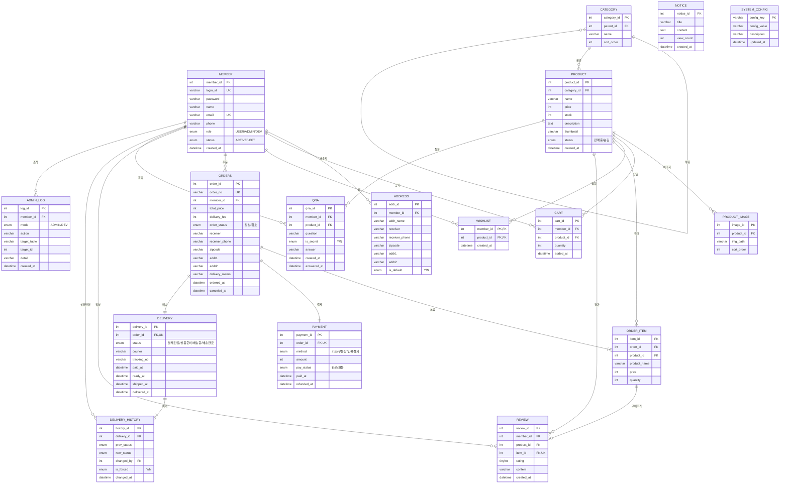

# ERD & 테이블 명세

> MySQL 9.6.0 / InnoDB / utf8mb4 · 스키마 `webapplication_sandbox` · 짝 문서 `docs/CRUD.md`

## 1. 공통 규약

| 항목 | 규약 |
|---|---|
| 스키마 | `webapplication_sandbox` (utf8mb4_unicode_ci) · 테이블명 접두사 없음 |
| PK | `INT UNSIGNED AUTO_INCREMENT` (`system_config` 만 자연키) |
| 시각 | 전부 `DATETIME` (`DATE` 금지) · 기본값 `CURRENT_TIMESTAMP` |
| 금액 · 수량 · 재고 | `INT UNSIGNED` — 음수 금지를 타입으로 |
| 고정 어휘 | `ENUM` |
| 문자열 | `VARCHAR(n)` 은 문자 수 · 장문은 `TEXT` |
| FK | 전부 `ON UPDATE RESTRICT` · `ON DELETE` 는 각 테이블 표 |
| 이미지 경로 | 파일은 `WebContents/upload/`, DB 에는 `/upload/<파일명>` 만 |

## 2. ERD



- 주문 배송지(`orders`) · 주문 시점 상품명·단가(`order_item`)는 **복사본**이다. 원본이 바뀌어도 과거 주문은 그대로다.
- 카테고리는 `parent_id` 자기 참조 2단(대분류 · 소분류).

## 3. 테이블 명세

### `member` — 회원

| 컬럼 | 타입 | 제약 | 설명 |
|---|---|---|---|
| member_id | INT UNSIGNED | PK, AUTO_INCREMENT | 회원 번호 |
| login_id | VARCHAR(30) | NOT NULL, UNIQUE | 로그인 아이디 |
| password | VARCHAR(100) | NOT NULL | 비밀번호 (해시 저장) |
| name | VARCHAR(30) | NOT NULL | 이름 |
| email | VARCHAR(100) | NOT NULL, UNIQUE | 이메일 |
| phone | VARCHAR(20) | NOT NULL | 연락처 |
| role | ENUM('USER','ADMIN','DEV') | NOT NULL DEFAULT 'USER' | 권한 |
| status | ENUM('ACTIVE','LEFT') | NOT NULL DEFAULT 'ACTIVE' | 탈퇴 여부 (소프트 삭제) |
| created_at | DATETIME | NOT NULL DEFAULT CURRENT_TIMESTAMP | 가입일시 |

### `address` — 회원 배송지

| 컬럼 | 타입 | 제약 | 설명 |
|---|---|---|---|
| addr_id | INT UNSIGNED | PK, AUTO_INCREMENT | 배송지 번호 |
| member_id | INT UNSIGNED | NOT NULL, FK → member ON DELETE CASCADE | 소유 회원 |
| addr_name | VARCHAR(30) | NULL | 별칭 (집, 회사, 기숙사) |
| receiver | VARCHAR(30) | NOT NULL | 받는 사람 |
| receiver_phone | VARCHAR(20) | NOT NULL | 받는 사람 연락처 |
| zipcode | VARCHAR(10) | NOT NULL | 우편번호 |
| addr1 | VARCHAR(200) | NOT NULL | 기본 주소 |
| addr2 | VARCHAR(200) | NULL | 상세 주소 |
| is_default | ENUM('Y','N') | NOT NULL DEFAULT 'N' | 기본 배송지 여부 |

### `category` — 카테고리

| 컬럼 | 타입 | 제약 | 설명 |
|---|---|---|---|
| category_id | INT UNSIGNED | PK, AUTO_INCREMENT | 카테고리 번호 |
| parent_id | INT UNSIGNED | NULL, FK → category ON DELETE RESTRICT | NULL 이면 대분류 |
| name | VARCHAR(50) | NOT NULL | 카테고리명 |
| sort_order | INT | NOT NULL DEFAULT 0 | 메뉴 표시 순서 |

### `product` — 상품

| 컬럼 | 타입 | 제약 | 설명 |
|---|---|---|---|
| product_id | INT UNSIGNED | PK, AUTO_INCREMENT | 상품 번호 |
| category_id | INT UNSIGNED | NOT NULL, FK → category ON DELETE RESTRICT | 소분류 |
| name | VARCHAR(100) | NOT NULL | 상품명 |
| price | INT UNSIGNED | NOT NULL | 판매가 |
| stock | INT UNSIGNED | NOT NULL DEFAULT 0 | 재고 |
| description | TEXT | NULL | 상세 설명 |
| thumbnail | VARCHAR(200) | NULL | 대표 이미지 — `/upload/<파일명>` |
| status | ENUM('판매중','숨김') | NOT NULL DEFAULT '판매중' | 전시 상태 — 관리자 의도만 담는다 |
| created_at | DATETIME | NOT NULL DEFAULT CURRENT_TIMESTAMP | 등록일시 |

### `product_image` — 상품 이미지

| 컬럼 | 타입 | 제약 | 설명 |
|---|---|---|---|
| image_id | INT UNSIGNED | PK, AUTO_INCREMENT | 이미지 번호 |
| product_id | INT UNSIGNED | NOT NULL, FK → product ON DELETE CASCADE | 상품 |
| img_path | VARCHAR(200) | NOT NULL | 웹 참조 경로 — `/upload/<파일명>` |
| sort_order | INT | NOT NULL DEFAULT 0 | 표시 순서 |

### `cart` — 장바구니

| 컬럼 | 타입 | 제약 | 설명 |
|---|---|---|---|
| cart_id | INT UNSIGNED | PK, AUTO_INCREMENT | 장바구니 줄 번호 |
| member_id | INT UNSIGNED | NOT NULL, FK → member ON DELETE CASCADE | 회원 |
| product_id | INT UNSIGNED | NOT NULL, FK → product ON DELETE CASCADE | 상품 |
| quantity | INT UNSIGNED | NOT NULL, CHECK (quantity > 0) | 수량 |
| added_at | DATETIME | NOT NULL DEFAULT CURRENT_TIMESTAMP | 담은 시각 |

### `wishlist` — 찜

| 컬럼 | 타입 | 제약 | 설명 |
|---|---|---|---|
| member_id | INT UNSIGNED | PK, FK → member ON DELETE CASCADE | 회원 |
| product_id | INT UNSIGNED | PK, FK → product ON DELETE CASCADE | 상품 |
| created_at | DATETIME | NOT NULL DEFAULT CURRENT_TIMESTAMP | 찜한 시각 |

### `orders` — 주문

| 컬럼 | 타입 | 제약 | 설명 |
|---|---|---|---|
| order_id | INT UNSIGNED | PK, AUTO_INCREMENT | 주문 번호 (내부) |
| order_no | VARCHAR(20) | NOT NULL, UNIQUE | 화면 표시용 (예: `20261029-0001`) |
| member_id | INT UNSIGNED | NOT NULL, FK → member ON DELETE RESTRICT | 주문 회원 |
| total_price | INT UNSIGNED | NOT NULL | 상품 합계 |
| delivery_fee | INT UNSIGNED | NOT NULL DEFAULT 0 | 배송비 (주문 시점 복사본) |
| order_status | ENUM('정상','취소') | NOT NULL DEFAULT '정상' | 주문 상태 (배송 상태와 별개) |
| receiver | VARCHAR(30) | NOT NULL | 받는 사람 (복사본) |
| receiver_phone | VARCHAR(20) | NOT NULL | 연락처 (복사본) |
| zipcode | VARCHAR(10) | NOT NULL | 우편번호 (복사본) |
| addr1 | VARCHAR(200) | NOT NULL | 기본 주소 (복사본) |
| addr2 | VARCHAR(200) | NULL | 상세 주소 (복사본) |
| delivery_memo | VARCHAR(200) | NULL | 배송 요청사항 |
| ordered_at | DATETIME | NOT NULL DEFAULT CURRENT_TIMESTAMP | 주문일시 |
| canceled_at | DATETIME | NULL | 취소일시 |

### `order_item` — 주문 상품

| 컬럼 | 타입 | 제약 | 설명 |
|---|---|---|---|
| item_id | INT UNSIGNED | PK, AUTO_INCREMENT | 주문 상품 번호 |
| order_id | INT UNSIGNED | NOT NULL, FK → orders ON DELETE CASCADE | 주문 |
| product_id | INT UNSIGNED | NOT NULL, FK → product ON DELETE RESTRICT | 상품 |
| product_name | VARCHAR(100) | NOT NULL | 주문 시점 상품명 (복사본) |
| price | INT UNSIGNED | NOT NULL | 주문 시점 단가 (복사본) |
| quantity | INT UNSIGNED | NOT NULL, CHECK (quantity > 0) | 수량 |

### `payment` — 결제 (모의)

| 컬럼 | 타입 | 제약 | 설명 |
|---|---|---|---|
| payment_id | INT UNSIGNED | PK, AUTO_INCREMENT | 결제 번호 |
| order_id | INT UNSIGNED | NOT NULL, UNIQUE, FK → orders ON DELETE CASCADE | 주문 (1:1) |
| method | ENUM('카드','무통장','간편결제') | NOT NULL | 결제 수단 (버튼 선택값만 저장) |
| amount | INT UNSIGNED | NOT NULL | `total_price + delivery_fee` |
| pay_status | ENUM('완료','환불') | NOT NULL DEFAULT '완료' | 결제 상태 |
| paid_at | DATETIME | NOT NULL DEFAULT CURRENT_TIMESTAMP | 결제일시 |
| refunded_at | DATETIME | NULL | 환불일시 |

### `delivery` — 배송

| 컬럼 | 타입 | 제약 | 설명 |
|---|---|---|---|
| delivery_id | INT UNSIGNED | PK, AUTO_INCREMENT | 배송 번호 |
| order_id | INT UNSIGNED | NOT NULL, UNIQUE, FK → orders ON DELETE CASCADE | 주문 (1:1) |
| status | ENUM('결제완료','상품준비','배송중','배송완료') | NOT NULL DEFAULT '결제완료' | 배송 상태 |
| courier | VARCHAR(30) | NULL | 택배사 |
| tracking_no | VARCHAR(30) | NULL | 운송장 번호 (임의 입력, 외부 조회 없음) |
| paid_at | DATETIME | NULL | 결제완료 시각 |
| ready_at | DATETIME | NULL | 상품준비 시각 |
| shipped_at | DATETIME | NULL | 배송중 전환 시각 |
| delivered_at | DATETIME | NULL | 배송완료 시각 |

### `delivery_history` — 배송 상태 이력

| 컬럼 | 타입 | 제약 | 설명 |
|---|---|---|---|
| history_id | INT UNSIGNED | PK, AUTO_INCREMENT | 이력 번호 |
| delivery_id | INT UNSIGNED | NOT NULL, FK → delivery ON DELETE CASCADE | 배송 |
| prev_status | ENUM('결제완료','상품준비','배송중','배송완료') | NULL | 이전 상태 (최초 생성 시 NULL) |
| new_status | ENUM('결제완료','상품준비','배송중','배송완료') | NOT NULL | 변경된 상태 |
| changed_by | INT UNSIGNED | NULL, FK → member ON DELETE SET NULL | 변경자 (시스템 자동이면 NULL) |
| is_forced | ENUM('Y','N') | NOT NULL DEFAULT 'N' | `/dev` 강제 변경 여부 |
| changed_at | DATETIME | NOT NULL DEFAULT CURRENT_TIMESTAMP | 변경 시각 |

### `review` — 리뷰

| 컬럼 | 타입 | 제약 | 설명 |
|---|---|---|---|
| review_id | INT UNSIGNED | PK, AUTO_INCREMENT | 리뷰 번호 |
| member_id | INT UNSIGNED | NOT NULL, FK → member ON DELETE RESTRICT | 작성자 |
| product_id | INT UNSIGNED | NOT NULL, FK → product ON DELETE RESTRICT | 상품 |
| item_id | INT UNSIGNED | NOT NULL, UNIQUE, FK → order_item ON DELETE CASCADE | 구매 건 (1건당 리뷰 1개) |
| rating | TINYINT UNSIGNED | NOT NULL, CHECK (rating BETWEEN 1 AND 5) | 별점 |
| content | VARCHAR(1000) | NOT NULL | 내용 |
| created_at | DATETIME | NOT NULL DEFAULT CURRENT_TIMESTAMP | 작성일시 |

### `qna` — 상품 문의

| 컬럼 | 타입 | 제약 | 설명 |
|---|---|---|---|
| qna_id | INT UNSIGNED | PK, AUTO_INCREMENT | 문의 번호 |
| member_id | INT UNSIGNED | NOT NULL, FK → member ON DELETE RESTRICT | 작성자 |
| product_id | INT UNSIGNED | NOT NULL, FK → product ON DELETE RESTRICT | 상품 |
| question | VARCHAR(1000) | NOT NULL | 문의 내용 |
| is_secret | ENUM('Y','N') | NOT NULL DEFAULT 'N' | 비밀글 여부 |
| answer | VARCHAR(1000) | NULL | 관리자 답변 |
| created_at | DATETIME | NOT NULL DEFAULT CURRENT_TIMESTAMP | 작성일시 |
| answered_at | DATETIME | NULL | 답변일시 |

### `notice` — 공지사항

| 컬럼 | 타입 | 제약 | 설명 |
|---|---|---|---|
| notice_id | INT UNSIGNED | PK, AUTO_INCREMENT | 공지 번호 |
| title | VARCHAR(200) | NOT NULL | 제목 |
| content | TEXT | NOT NULL | 내용 |
| view_count | INT UNSIGNED | NOT NULL DEFAULT 0 | 조회수 |
| created_at | DATETIME | NOT NULL DEFAULT CURRENT_TIMESTAMP | 작성일시 |

### `system_config` — 전역 설정

| 컬럼 | 타입 | 제약 | 설명 |
|---|---|---|---|
| config_key | VARCHAR(50) | PK | 설정 키 |
| config_value | VARCHAR(200) | NOT NULL | 설정 값 |
| description | VARCHAR(200) | NULL | 설명 |
| updated_at | DATETIME | NOT NULL DEFAULT CURRENT_TIMESTAMP ON UPDATE CURRENT_TIMESTAMP | 수정 시각 |

초기값

| key | value | 설명 |
|---|---|---|
| `SHOP_STATUS` | `OPEN` | `OPEN` / `MAINTENANCE` — 점검 모드 |
| `DELIVERY_FEE` | `3000` | 기본 배송비 (원) |
| `FREE_SHIPPING_MIN` | `50000` | 무료배송 기준 금액 (원) |
| `LOW_STOCK_THRESHOLD` | `5` | 대시보드 "재고 부족" 기준 |

### `admin_log` — 관리자·dev 조작 기록

| 컬럼 | 타입 | 제약 | 설명 |
|---|---|---|---|
| log_id | INT UNSIGNED | PK, AUTO_INCREMENT | 로그 번호 |
| member_id | INT UNSIGNED | NOT NULL, FK → member ON DELETE RESTRICT | 조작한 계정 |
| mode | ENUM('ADMIN','DEV') | NOT NULL | 조작 모드 |
| action | VARCHAR(50) | NOT NULL | 예: `FORCE_DELIVERY_STATUS` |
| target_table | VARCHAR(30) | NULL | 대상 테이블 |
| target_id | INT UNSIGNED | NULL | 대상 PK |
| detail | VARCHAR(500) | NULL | 변경 전 → 후 값 |
| created_at | DATETIME | NOT NULL DEFAULT CURRENT_TIMESTAMP | 시각 |

`action` 어휘 (고정)

| action | mode | 대상 |
|---|---|---|
| `PRODUCT_CREATE` / `PRODUCT_UPDATE` / `PRODUCT_DELETE` | ADMIN | product |
| `CATEGORY_CREATE` / `CATEGORY_UPDATE` / `CATEGORY_DELETE` | ADMIN | category |
| `DELIVERY_NEXT_STEP` | ADMIN | delivery |
| `DELIVERY_TRACKING_SET` | ADMIN | delivery |
| `ORDER_CANCEL` | ADMIN | orders |
| `MEMBER_LEAVE` | ADMIN | member |
| `QNA_ANSWER` | ADMIN | qna |
| `REVIEW_DELETE` | ADMIN | review — 35번 관리자 리뷰관리 |
| `NOTICE_CREATE` / `NOTICE_UPDATE` / `NOTICE_DELETE` | ADMIN | notice |
| `FORCE_DELIVERY_STATUS` | DEV | delivery |
| `FORCE_ORDER_STATUS` | DEV | orders |
| `FORCE_PAY_STATUS` | DEV | payment |
| `FORCE_STOCK_SET` | DEV | product |
| `SHOP_STATUS_TOGGLE` | DEV | system_config — `SHOP_STATUS` 점검 모드 전환 전용 |
| `CONFIG_UPDATE` | DEV | system_config — `SHOP_STATUS` 외 설정값 변경. `detail` 에 `키: 전 → 후` |
| `SEED_GENERATE` / `SEED_TRUNCATE_ALL` / `SEED_TRUNCATE_TABLE` | DEV | — |
| `LOGIN_AS` | DEV | member |
| `LOGIN_AS_RETURN` | DEV | member — `impersonatorId` 의 DEV 로 기록 |

## 4. 제약

### 4.1 CHECK (8)

| 테이블 | 조건 |
|---|---|
| `cart` · `order_item` | `quantity > 0` |
| `review` | `rating BETWEEN 1 AND 5` |
| `qna` | `answer` 와 `answered_at` 은 둘 다 NULL 이거나 둘 다 NOT NULL |
| `orders` | `order_status='취소'` ⟺ `canceled_at IS NOT NULL` |
| `payment` | `pay_status='환불'` ⟺ `refunded_at IS NOT NULL` |
| `delivery_history` | `prev_status IS NULL OR prev_status <> new_status` |
| `delivery` | `배송중`·`배송완료` 이면 `courier` · `tracking_no` NOT NULL |

### 4.2 복합 키

| 테이블 | 키 |
|---|---|
| `cart` | `UNIQUE (member_id, product_id)` |
| `wishlist` | `PRIMARY KEY (member_id, product_id)` |
| `product_image` | `UNIQUE (product_id, sort_order)` |
| `category` | `UNIQUE (parent_id, name)` — `parent_id IS NULL` 인 대분류는 보호되지 않음 |

### 4.3 인덱스 (FK 자동 인덱스 외)

| 인덱스 | 대상 | 쓰이는 화면 |
|---|---|---|
| `idx_product_category_status (category_id, status)` | product | 카테고리별 목록 |
| `idx_product_created (created_at)` | product | 메인 신상품 |
| `idx_orders_member_ordered (member_id, ordered_at)` | orders | 주문내역 |
| `idx_orders_ordered (ordered_at)` | orders | 대시보드 일별 매출 |
| `idx_review_product_created (product_id, created_at)` | review | 상품 상세 리뷰 |
| `idx_qna_product_created (product_id, created_at)` | qna | 상품 상세 문의 |
| `idx_qna_unanswered (answered_at)` | qna | 미답변 목록 (`answered_at IS NULL`)|
| `idx_delivery_history_timeline (delivery_id, changed_at)` | delivery_history | 배송 타임라인 |
| `idx_admin_log_created (created_at)` | admin_log | `/dev` 로그 조회 |

- `qna.answer` 에는 인덱스를 걸지 않는다 (utf8mb4 4000 byte > 키 한계 3072). 미답변 판정은 `answered_at IS NULL`.

### 4.4 생성 순서

`member` → `category` → `product` → `notice` → `system_config` → `address` → `product_image` → `cart` → `wishlist` → `orders` → `order_item` → `payment` → `delivery` → `delivery_history` → `review` → `qna` → `admin_log` → 뷰 5개. `DROP` 은 역순. 샘플 `category` 는 대분류 먼저.

## 5. 뷰

| 뷰 | 용도 | 원천 · 조건 |
|---|---|---|
| `v_sales_daily` | 일별 매출 | `orders` 만 집계 (`order_status='정상'`) — `order_item` 조인 시 배송비 중복 |
| `v_delivery_status_count` | 배송 상태별 건수 | `delivery` + 정상 주문. 0건 상태는 행이 없으므로 화면에서 0 을 채운다 |
| `v_admin_order` | 관리자 주문 목록 | `orders` + `member` + `payment`·`delivery`(LEFT) + 상품 수·첫 상품명 |
| `v_admin_member` | 관리자 회원 목록 | `member` + 정상 주문 수·결제 합계·최근 주문·리뷰 수·미답변 문의(`answered_at IS NULL`) |
| `v_low_stock` | 재고 부족 | `status='판매중' AND stock <= LOW_STOCK_THRESHOLD` — 재고 0 상품을 관리자가 아는 유일한 경로 |

## 6. 권한 · 라우팅 — 3개 역할 완전 격리

| 역할 | 하는 일 | 접근 경로 | 하지 않는 일 |
|---|---|---|---|
| `USER` | 구매 — 장바구니 · 찜 · 주문 · 결제 · 취소 · 리뷰 · 문의 · 배송지 · 회원정보 | 구매 경로 | `/admin/*` · `/dev/*` |
| `ADMIN` | 상품 · 주문 관리 — 상품 · 카테고리 · 주문 · 배송 · 회원 탈퇴 · 문의 답변 · 리뷰 삭제 · 공지 | `/admin/*` | 구매 · `/dev/*` |
| `DEV` | 전체 데이터 · 상태 전환 조작 — 데이터 조회·초기화, 상태 강제 전환, 점검 모드, 계정 전환 | `/dev/*` | 구매 · `/admin/*` |

| 경로 | 비로그인 | USER | ADMIN | DEV |
|---|---|---|---|---|
| 공개 탐색 — 메인 · 상품목록 · 상품상세 · 공지 · 점검안내 | ○ 열람 | ○ | ○ 열람 | ○ 열람 |
| 회원가입 · 로그인 | ○ | — | — | — |
| 구매 경로 — `/cart/*` · `/order/*` · `/mypage/*` · 찜 토글 · 리뷰/문의 작성 | ✕ → 로그인 | ○ | ✕ | ✕ |
| `/admin/*` | ✕ | ✕ | ○ | ✕ |
| `/dev/*` | ✕ | ✕ | ✕ | ○ |

| 규칙 | 내용 |
|---|---|
| 가입 | 항상 `role='USER'`. `role` 파라미터는 무시 |
| ADMIN · DEV 계정 | `sql/data.sql` 로만 생성 |
| 역할 변경 | 불가 — 생성 후 불변 |
| 구매 컨트롤 | 상품상세의 담기·찜·문의는 USER 에게만 노출. 서버는 필터로 별도 거부 |
| 로그인 착지 | USER → 원래 페이지·메인 / ADMIN → `/admin/dashboard` / DEV → `/dev/` |
| 거부 시 | 비로그인 → 로그인 / ADMIN·DEV → 각자 홈 |
| `login-as` | DEV 전용. 대상은 `ACTIVE` 인 USER·ADMIN. 세션 회원·역할을 대상으로 교체, 원래 DEV 는 `impersonatorId` 로 보관 |
| `login-as` 복귀 | `/dev/loginAs/return` 은 역할 대신 `impersonatorId` 로 판정. `LOGIN_AS_RETURN` 은 원래 DEV 로 기록 |
| 전환 중 로그 | `admin_log.detail` 에 `impersonated_by=<devId>` |

```
1. EncodingFilter   /*            요청 인코딩 UTF-8
2. ShopFilter       /*            SHOP_STATUS=MAINTENANCE 면 비로그인 · USER 를 점검 페이지로.
                                  /admin/*, /dev/*, 로그인, 정적 자원(css·js·images·upload)은 통과
3. UserFilter       구매 경로      role = 'USER'   (비로그인 → 로그인 / ADMIN·DEV → 각자 홈)
4. AdminFilter      /admin/*      role = 'ADMIN'  (DEV 도 거부)
5. DevFilter        /dev/*        role = 'DEV'    (단 /dev/loginAs/return 은 impersonatorId 로 판정)
```

## 7. 업무 규칙

| 영역 | 규칙 |
|---|---|
| 상품 노출 | 탐색 경로(메인·목록·검색·상세)는 `status='판매중' AND stock > 0`. 상세는 직접 URL 도 차단 |
| 노출 예외 | 장바구니 · 찜은 행을 보여주고 "재고 없음" 표시, 주문 대상에서만 제외 |
| 숨김 vs 재고 0 | `숨김` 은 재입고돼도 복귀하지 않음(관리자가 되돌림) · `stock=0` 은 재입고 시 자동 노출 |
| 결제 (한 트랜잭션) | `orders` → `order_no` 채움 → `order_item` → `payment` → `delivery`(결제완료) → `delivery_history` → 재고 차감(`WHERE stock >= ?`, 0행이면 rollback) → 장바구니 비우기 |
| `order_no` | INSERT 후 `날짜-LPAD(order_id)` 로 UPDATE (같은 트랜잭션) |
| 배송비 | `total_price >= FREE_SHIPPING_MIN` 이면 0, 아니면 `DELIVERY_FEE`. 주문 시점 값을 복사 |
| 배송 전이 | `UPDATE ... WHERE status = 직전상태`, 0행이면 rollback. 성공 시 `delivery_history` + `admin_log` |
| 주문 취소 | `결제완료`·`상품준비` 에서만. 주문 `취소`+`canceled_at`, 결제 `환불`+`refunded_at`, 재고 복구. `admin_log` 는 관리자 취소만 |
| 취소 주문 조회 | 배송조회는 `orders.order_status` 를 먼저 보고 취소면 타임라인 대신 "취소 완료" |
| `/dev` 강제 전환 | 상태와 시각 컬럼을 함께 맞춘다. 역방향이면 이후 시각·운송장 NULL. `delivery_history(is_forced='Y')` + `admin_log`. 강제 취소는 재고 복구 선택 |
| `/dev` 데이터 브라우저 | 테이블·뷰·정렬 컬럼은 화이트리스트(17 테이블 + 뷰 5)로만 SQL 에 넣는다 |
| `/dev` 설계 보기 | ERD 는 이미지로 표시 · 실제 스키마는 `information_schema` + `DATABASE()` 로 조회 |
| `/dev` 초기화 | `FOREIGN_KEY_CHECKS=0` 후 TRUNCATE. `member` 는 `role='USER'` 만 삭제 |
| 기본 배송지 | 한 트랜잭션: 회원 전체 `N` → 대상 `Y` (`AND member_id=?`) |
| 리뷰 | 배송완료 건만 · 구매 건당 1회 · 선택. `product_id` 는 `item_id` 로 조회해 채움. 수정은 작성자만, 삭제는 작성자·ADMIN |
| 문의 답변 | `answer` 와 `answered_at` 은 같은 UPDATE 로 |
| 평균 별점 | 컬럼 없음. `review` 집계, 목록은 LEFT JOIN + GROUP BY |
| 작성자명 | 리뷰·문의 공개 목록은 DTO 세팅 시 마스킹 (`홍*동`) |
| 설정값 | `system_config` 파싱 실패 대비 코드 기본값을 둔다 |

## 8. 불변식 — DB 가 강제하지 못하는 것

| # | 불변식 | 지키는 곳 |
|---|---|---|
| 1 | `orders.total_price` = Σ(`order_item.price` × `quantity`) | 결제 트랜잭션 |
| 2 | `payment.amount` = `total_price` + `delivery_fee` | 결제 트랜잭션 |
| 3 | 회원별 `is_default='Y'` 최대 1건 | 기본 배송지 트랜잭션 |
| 4 | 리뷰는 `delivery.status='배송완료'` 인 건에만 | 리뷰 작성 처리 |
| 5 | `review.product_id` = `order_item.product_id` | `item_id` 로 조회해 채움 |
| 6 | 배송 상태 단방향 전이 (`/dev` 제외) | 직전상태 가드 |
| 7 | `role` 생성 후 불변 | 가입 · 회원관리 처리 |
| 8 | 구매 계열(`address`·`cart`·`wishlist`·`orders`·`review`·`qna`) 행은 USER 회원만 · `admin_log.mode` = 행위자 `role` · `delivery_history.changed_by` 는 정상 전이 ADMIN / 강제 DEV / 자동 NULL | 역할 필터 + 역할 불변 |

## 9. DTO 필드 계약

| DB | Java | 이유 |
|---|---|---|
| `INT UNSIGNED` (PK·FK·금액·수량) | `int` | AUTO_INCREMENT 가 21억을 넘지 않는다. NULL 허용 FK 는 `Integer` |
| `TINYINT UNSIGNED` | `int` | 별점 1~5 |
| `VARCHAR` / `TEXT` / `ENUM` | `String` | ENUM 은 JSTL 문자열 비교(`${d.status == '배송중'}`)로 그대로 쓴다 |
| `DATETIME` | `java.sql.Timestamp` | `<fmt:formatDate>` 가 `java.util.Date` 를 요구한다. `Timestamp` 는 그 하위 타입이라 바로 들어간다. `LocalDateTime` 은 별도 변환이 필요하다 |

| DTO | 필드 |
|---|---|
| `MemberDTO` | `int memberId` · `String loginId, password, name, email, phone, role, status` · `Timestamp createdAt` |
| `AddressDTO` | `int addrId, memberId` · `String addrName, receiver, receiverPhone, zipcode, addr1, addr2, isDefault` |
| `CategoryDTO` | `int categoryId` · `Integer parentId` · `String name` · `int sortOrder` · `List<CategoryDTO> children` |
| `ProductDTO` | `int productId, categoryId` · `String categoryName` *(조인)* · `String name` · `int price, stock` · `String description, thumbnail, status` · `Timestamp createdAt` · `List<ProductImageDTO> images` · `double avgRating` · `int reviewCount` *(집계)* |
| `ProductImageDTO` | `int imageId, productId` · `String imgPath` · `int sortOrder` |
| `CartItemDTO` | `int cartId, memberId, productId` · `String productName, thumbnail, status` · `int price, stock, quantity` · `int lineTotal` *(유도: price × quantity)* |
| `WishItemDTO` | `int memberId, productId` · `String productName, thumbnail, status` · `int price` · `Timestamp createdAt` |
| `OrderDTO` | `int orderId` · `String orderNo` · `int memberId` · `int totalPrice, deliveryFee, payAmount` *(유도)* · `String orderStatus, receiver, receiverPhone, zipcode, addr1, addr2, deliveryMemo` · `Timestamp orderedAt, canceledAt` · `List<OrderItemDTO> items` · `PaymentDTO payment` · `DeliveryDTO delivery` |
| `OrderItemDTO` | `int itemId, orderId, productId` · `String productName` · `int price, quantity, lineTotal` *(유도)* · `boolean reviewWritten` *(유도)* |
| `PaymentDTO` | `int paymentId, orderId` · `String method, payStatus` · `int amount` · `Timestamp paidAt, refundedAt` |
| `DeliveryDTO` | `int deliveryId, orderId` · `String status, courier, trackingNo` · `Timestamp paidAt, readyAt, shippedAt, deliveredAt` · `List<DeliveryHistoryDTO> history` |
| `DeliveryHistoryDTO` | `int historyId, deliveryId` · `String prevStatus, newStatus, isForced` · `Integer changedBy` · `String changedByName` *(조인)* · `Timestamp changedAt` |
| `ReviewDTO` | `int reviewId, memberId, productId, itemId` · `String memberName` *(마스킹)* · `String productName` *(조인)* · `int rating` · `String content` · `Timestamp createdAt` |
| `QnaDTO` | `int qnaId, memberId, productId` · `String memberName` *(마스킹)* · `String productName` *(조인)* · `String question, isSecret, answer` · `Timestamp createdAt, answeredAt` |
| `NoticeDTO` | `int noticeId` · `String title, content` · `int viewCount` · `Timestamp createdAt` |
| `SystemConfigDTO` | `String configKey, configValue, description` · `Timestamp updatedAt` |
| `AdminLogDTO` | `int logId, memberId` · `String memberName` *(조인)* · `String mode, action, targetTable, detail` · `Integer targetId` · `Timestamp createdAt` |
| `SalesDailyDTO` | `java.sql.Date salesDate` · `int orderCount, goodsAmount, deliveryAmount, totalAmount` |
| `DeliveryStatusCountDTO` | `String deliveryStatus` · `int orderCount` |
| `LowStockDTO` | `int productId` · `String name, status, categoryName` · `int stock` |
| `PageDTO<T>` | `List<T> list` · `int page, size, total, totalPages` |

- 유도 필드(`payAmount` · `lineTotal` · `reviewWritten` · `avgRating` · `reviewCount`)는 DB 컬럼이 아니다.
